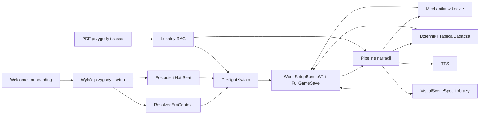
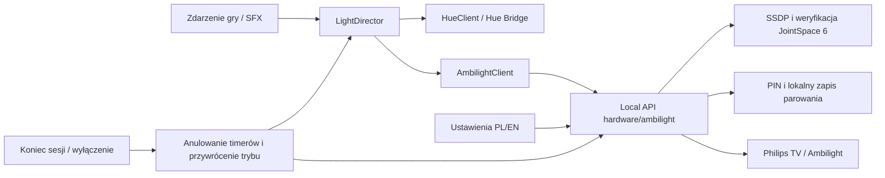

# Mapa powiązań runtime

Stan na 2026-09-01. Mapa opisuje faktyczny runtime w `_tester/_base/.silnik`.
Root `docs/` jest źródłem prawdy dokumentacji. `navigation/navigation-registry.json`
jest źródłem prawdy nawigacji. Istniejący graf Graft jest materiałem pomocniczym,
nie dowodem aktualnego przebiegu runtime.

## Główny przepływ gry

## Kontrakty między systemami

| Producent | Kontrakt | Konsument | Trwałość |
|---|---|---|---|
| Setup epoki | `ResolvedEraContext` | preflight, prompty, ekwipunek, obrazy | `FullGameSave.worldSetup` i stan sesji |
| Manifest epoki | `EraManifestV1` | preflight i centralny kontrakt promptów | wersjonowane dane runtime |
| Analiza przygody i preflight | `WorldSetupBundleV1` | chat, pamięć, save/load | `FullGameSave.worldSetup` |
| Specyfikacja sceny | `VisualSceneSpec` | adapter obrazu i test promptu | cache obrazu i metadata |
| Kreator postaci | `Character` | Hot Seat, karta, mechanika, save | localStorage i `FullGameSave` |
| Katalog ekwipunku | `templateId` i `EquipmentItem` | postać, dziennik, renderer | save i lokalny asset WebP |
| Magia i tomiska d100 Weird Fiction | `CharacterMagicState`, `SpellDefinition`, `TomeDefinition` | silnik magii, karta postaci, save | stan postaci (`Character.magic`) i save |
| Wynik testu | wynik mechaniczny z kodu | narracja i dziennik | wiadomości i save |
| Adjudykacja intencji (Concordia) | `PutativeEvent`, `RealEvent`, `CheckRequirement` | pipeline narracji, prompt MG | wiadomości sesji i prompt dodatkowy |
| Lokalny RAG | trafienia z namespace rules, adventure, mythos, memory | preflight i chat | dane na dysku |
| Rejestr nawigacji | 31 węzłów i 30 akcji | guard, generator mapy, E2E | JSON w runtime |

## Granice odpowiedzialności

- Kod ustala mechanikę, stan gry, dostępność, ceny i wybór wyposażenia.
- AI redaguje narrację i opis, ale nie zmienia po cichu kanonu zapisanego w `WorldSetupBundleV1`.
- Każda ścieżka epoki ma używać `ResolvedEraContext`. Brak roku nie może dawać cichego fallbacku do 1920.
- Research online może działać przed sesją, ale nie podczas gry.
- Katalogowy przedmiot nie uruchamia API obrazu. Brak WebP daje ikonę kategorii.
- Samodzielny runtime nie może zależeć od danych istniejących wyłącznie w wrapperze.
- Dokumentacja systemowa żyje w root `docs/`; kopie runtime są generowane albo usuwane.

## Stan grafu i nawigacji

- `graft/.graph/wiring.json` ma 203 węzły i 377 krawędzi, ale pochodzi z commitu z 2026-08-24 i indeksuje głównie stare skrypty patchujące.
- Polecenie `graft` nie jest dostępne w środowisku, więc grafu nie można dziś odtworzyć ani uznać za żywy gate.
- Rejestr nawigacji ma 11 tras, 18 modali, 2 stany i 30 akcji. Jest sprawdzany przez `navigation:check` oraz `navigation:guard`.
- Faktyczny przepływ należy potwierdzać testami runtime i E2E, nie samym grafem statycznym.

## Lokalne przygotowanie i odbiór teczki

Źródło przygody -> `prepare-quicksetup.mjs` -> prywatny szkic rekordów i manifest mediów -> `scene-review.mjs` -> podgląd `review-scenes.mjs` -> eksport decyzji autora -> walidowany rejestr decyzji -> ponowna kompilacja szkicu. Hash zestawu łączy zgodę z rekordami, warunkami, referencjami, grafem, zasadami i mediami. Ten przepływ przygotowania nie aktywuje samodzielnie teczki w sesji gry. [Instrukcja](adventure-dossiers/GROUPED-REVIEW.md).

Scenariusz + prywatny szkic teczki + inwentaryzacja mediów + opcjonalny początek gracza -> `adventure-map-model.mjs` -> węzły i relacje autora -> prywatna paczka `build-adventure-map.mjs` -> przestrzenny HTML `adventure-map-render.mjs`. Źródłowe sceny, zdarzenia adaptacji, materiały i sekrety zachowują odrębne znaczenie. [Opis mapy](adventure-dossiers/ADVENTURE-MAP.md).

### Szybki pokaz Prabut PL (29.10.2026)

QuickSetupModal -> page.tsx -> useGameStart/useChat -> response-gate -> prabuty-action-plan. player-action-clauses rozdziela zbiorczą turę na deklaracje postaci; local-handouts wiąże dostęp do materiału z jawnym działaniem. Wynik trafia przez apply-inventory-turn do właściciela przedmiotu i przez public-journal do kart wspólnego dziennika. Tożsamość miejsca pozostaje kanoniczna, zmienia się tylko etykieta. run-chat-pipeline przekazuje sygnał anulowania do Gemini; useTTS i endpoint syntezy rozróżniają jawny free BYOK od zweryfikowanego lokalnego klucza serwera. Zamrożony pakiet ma tę samą operacyjną teczkę 47 kart przy starcie z Biurka.

Plan Prabut -> filtr prozy ekwipunku -> komunikat operacji z nazwanym właścicielem/odbiorcą -> SSE -> zatwierdzenie pamięci. Ten sam plan -> idempotentna walidacja klienta -> dziennik/ekwipunek -> pełny zapis z kontrolą zgodności pamięci. `summarize-scene` używa modelu Lite i raportuje zużycie do licznika gry. Lokalny launcher wybiera macOS Zosia; partytura Hue przechodzi przez reżysera świateł po zaakceptowanym wejściu/scenie, a test fizyczny nadal wymaga mostka.

Próba pokazu 29.10 - domknięcie sanitacji: wspólny stripIncompletePrivateMarkers w parserze usuwa tylko niepełne linie prywatnego protokołu, zachowując kompletne/zagnieżdżone tagi i późniejszą mechanikę. Wywołanie przed applyPrabutyPlanToText zapewnia zgodność strumienia serwera, pamięci i bramki klienta; cleanupContent stanowi ten sam filtr prezentacji. document-fidelity zatrzymuje analizę na granicy aktu mowy i wymaga jawnego odczytu, nadal blokując fikcyjne cytaty inskrypcji. Plan czasu rozpoznaje pojedynczą podróż z osobnym zdaniem jej jawnego czasu, bez domyślnego kosztu i dodatkowych działań.

### Prabuty: zgodność publicznej narracji (29.10.2026)

`prabuty-action-plan` przekazuje `narrativeFacts` i korzysta z `prabuty-narrative-fidelity` przed publikacją w pipeline oraz w tej samej walidacji klienta. Prezentacja usuwa etykietę finału, pilnuje numeru źródłowej receptury i zastępuje rozpoznane samodzielne twierdzenia o upływie minut/kwadransów/godzin zapisanym czasem. To ograniczona ochrona rozpoznanych konstrukcji językowych, nie pełna semantyczna kontrola dowolnej narracji. Podpisane cytaty rozpoznaje wspólny parser dialogów; zachowuje skróty tytułów i pełną wypowiedź. Obserwacje bez podpisu zachowują cały akapit, aby nie ucinać cytatów przy kropce w skrócie. Źródło edycji, mechaniczne identyfikatory i zapisany czas pozostają kanoniczne.

### Publiczne wizytówki poznanych kart (30.10.2026)

`public-journal` wzbogaca wyłącznie poznane karty osoby lub odwiedzonego miejsca przez `journal/prepared-public-profiles`. Wspólny `npc-public-profile` łączy gotowy portret i bezpieczną rolę z jednoznaczną tożsamością w danej przygodzie; nie importuje sekretów ani prywatnego dossier. Wizytówka pozostaje osobna od cytowanego dowodu. Projekcja starszego zapisu zachowuje ID i stan odkryć; pełny cytat może odtworzyć wyłącznie z tej samej zaakceptowanej wiadomości. `SessionJournal` pokazuje małą ikonę zamiast pustego pola obrazu i nazywa źródło świadkiem, materiałem lub sceną. Dotychczasowa historia nawigacji zachowuje wyszukiwanie, przewinięcie i fokus. Odbiór całości wymaga renderu PL/EN w dostarczonym buildzie.

## Światło scen

JSON Prabut -> sceny i akcenty -> CueParser -> ImmersionTimeline -> segment lektora / zatwierdzony wynik mechaniki -> lokalny `/api/hue` -> HueSession -> HTTPS v2 lub DTLS HueStream. Podgląd i eksport teczki odczytują tę samą partyturę. Światło awaryjne i zwolnienie sesji anulują oczekujące efekty. Zapis gry przechowuje wyłącznie scenę i pauzę; klucze oraz migawka fizycznych lamp pozostają poza save'em. Supervisor zwalnia lampy przed zakończeniem serwera, a utrata kontaktu z oknem wygasza dzierżawę po 10 sekundach.

## Wspólne efekty Hue i Ambilight (2026-10-31)

HDMI dostarcza wyłącznie obraz. Aplikacja steruje Ambilight przez LAN niezależnie od Hue Bridge. Na czas przejęcia wyłącza aktywne Ambilight+hue w TV, aby dwa źródła nie sterowały tymi samymi lampami; po sesji przywraca zapisane ustawienie. Token generacji odrzuca opóźnione polecenia starej sesji po przywróceniu trybu TV.

### Teczka startera - przygotowanie

Źródło PDF -> karty scen/obsady/pomieszczeń i materiały PL/EN -> lokalny podgląd oraz rekordy YAML -> odbiór autora. Import PDF korzysta ze skorygowanego grafu i handoutów. Publikacja odkryć w turze, wykonanie zdarzeń i wydanie desktopowe wymagają osobnego odbioru; opis warunku w prompcie nie zastępuje deterministycznego wykonania. Szczegóły: `docs/adventure-dossiers/STARTER-PREPARATION.md`.

### Dostawa 0.9.6

Zweryfikowany commit -> kompilacja lokalna -> pakiet z własnym Node i potwierdzeniem buildu -> podpis aplikacji -> dotychczasowy profil gracza na 127.0.0.1:4050. Kopia poprzedniej aplikacji i danych umożliwia powrót. Archiwizacja katalogów roboczych zachowuje osobno historię Git i niezapisane pliki.

### Dziennik i głosy postaci

Zaakceptowana widoczna narracja -> wspólny `dialogue-parser` -> dialog z profilem/portretem NPC oraz segmenty głosu w `useTTS`. Bieżące ustawienia presetu -> narratorOnly w kolejce; nazwa postaci -> stałe przypisanie głosu. `sceneCards` i lokalne podsumowania -> publiczna projekcja kroniki -> `ChronicleView`; znane informacje -> `SessionJournal` -> pojedyncza rozmowa/materiał. Rzeczywiste rozpoczęcie odtwarzania -> `scene-soundscape`; pauza/stop/koniec kolejki/zmiana sceny zamykają albo wstrzymują tło.
